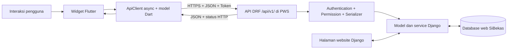

# SiBekas Mobile


**Barang lama, cerita baru.** Marketplace barang *preloved* untuk civitas akademika Universitas Indonesia, dengan tema **Sustainable Living**. SiBekas membantu mahasiswa menjual dan menemukan buku kuliah, pakaian, elektronik, serta perlengkapan kos yang masih layak pakai agar usia pakai barang lebih panjang dan belanja lebih terjangkau.

Proyek Akhir Semester Pemrograman Berbasis Platform (CSGE602022), Gasal 2026/2027, Fasilkom UI, **Kelas F - Kelompok 2**. Aplikasi Flutter ini merupakan versi mobile dari proyek web Django SiBekas. Backend dan database tetap berada pada proyek web; aplikasi mobile tidak menyimpan katalog atau transaksi sebagai data statis.

## Tautan proyek

- [Repositori Flutter](https://github.com/pbp-F-kelompok-2/SiBekas-mobile)
- [Repositori Django](https://github.com/pbp-F-kelompok-2/SiBekas)
- [Website PWS](https://faris-salman-sibekas.pws.cs.ui.ac.id/)
- [API DRF v1](https://faris-salman-sibekas.pws.cs.ui.ac.id/api/v1/)
- [Dokumentasi endpoint](docs/api.md) dan [checklist checkpoint 1](docs/checkpoint-1.md)
- [Rancangan wireframe lima modul](docs/wireframes.svg)
- [Pratinjau tampilan Flutter](docs/previews/README.md) (menggunakan fixture pengujian)
- **Figma:** belum tersedia; tautan desain final akan ditambahkan setelah checkpoint 1. Wireframe awal tersedia di repositori.
- **APK release (GitHub Releases dan Bitrise):** belum diterbitkan; ditambahkan pada tahap pengumpulan akhir. Build debug lokal dipakai untuk verifikasi kerangka aplikasi.

## Anggota dan pembagian modul

Anggota dan pemilik modul mengikuti proyek web PTS. Setiap anggota mengembangkan halaman Flutter **dan** serializer/API DRF modulnya di repositori Django.

| Nama | NPM | Modul | Direktori Flutter | Branch kerja yang disarankan |
| --- | --- | --- | --- | --- |
| Jehezkiel Jefferson I Latupeirissa | 2506611156 | Product | `lib/features/product/` | `feat/product-kiel` |
| Rachelin Miyuki Hendratmo | 2506536553 | Profile | `lib/features/profile/`, `lib/features/auth/` | `feat/profile-miyuki` |
| Rheza Abdilla | 2506612184 | Cart | `lib/features/cart/` | `feat/cart-rheza` |
| Faris Salman Azhari | 2506615223 | Order | `lib/features/order/` | `feat/order-faris` |
| Alfan Kurnia Karim | 2506537814 | Review | `lib/features/review/` | `feat/review-alfan` |

**Jehezkiel Jefferson I Latupeirissa - Product.** Bertanggung jawab atas katalog, pencarian/filter kategori, kondisi dan harga, detail barang, serta form tambah/edit/hapus listing penjual. Melanjutkan model `Product`, `Category`, dan `ProductImage` milik web; mengembangkan serializer, endpoint CRUD dengan pemeriksaan pemilik, serta parsing JSON dan interaksi Flutter. Dasar checkpoint 1: katalog dari API, pencarian, detail ringkas dan paginasi sudah tersedia. Tahap berikutnya melengkapi filter UI dan CRUD penjual.

**Rachelin Miyuki Hendratmo - Profile.** Bertanggung jawab atas login/registrasi/logout, data profil, edit profil, barang favorit, riwayat listing, serta penonaktifan akun dengan menjaga riwayat transaksi. Melanjutkan `Profile`, `Favorite`, dan akun Django; menjaga validasi data, pengelolaan autentikasi mobile dan pembatasan akses data pribadi. Dasar checkpoint 1: login/logout token, halaman profil dan favorit dari API tersedia; endpoint PATCH profil juga tersedia. Tahap berikutnya melengkapi registrasi, form edit, mutasi favorit, listing pribadi dan penonaktifan akun pada mobile.

**Rheza Abdilla - Cart.** Bertanggung jawab atas penambahan barang ke keranjang, daftar item, perubahan jumlah, penghapusan item dan subtotal yang mengikuti stok terbaru. Melanjutkan `Cart`, `CartItem` dan aturan `cart_summary` di web; menjaga agar produk sendiri/tidak tersedia tidak masuk subtotal dan mutasi hanya berlaku untuk keranjang pemilik. Dasar checkpoint 1: halaman keranjang mengambil item, ketersediaan dan subtotal dari API. Tahap berikutnya menambahkan endpoint mutasi, tombol tambah/kurang/hapus serta handoff ke checkout. Ikut memelihara komponen navigasi/layout bersama sesuai peran pada web.

**Faris Salman Azhari - Order.** Bertanggung jawab atas checkout COD/ambil kampus dan kurir, riwayat/detail pesanan, dashboard penjualan, pembatalan, nomor resi, serta transisi status dua pihak hingga pembeli mengonfirmasi penerimaan. Melanjutkan `Order`, `OrderItem`, `OrderEvent` dan service transaksi web agar validasi stok, harga dan otorisasi tetap dihitung di server. Dasar checkpoint 1: riwayat pembelian/penjualan dari API dan endpoint detail pembeli tersedia, termasuk antrean API khusus petugas. Tahap berikutnya melengkapi form checkout dan aksi transaksi mobile, UI petugas, integrasi ongkir, deployment PWS serta koordinasi APK GitHub Releases/Bitrise.

**Alfan Kurnia Karim - Review.** Bertanggung jawab atas daftar ulasan, rating 1-5, rata-rata rating dan tambah/edit/hapus ulasan untuk pembelian yang selesai. Melanjutkan model `Review`; menjaga aturan satu ulasan per pengguna/produk, verified purchase, batas 500 karakter dan otorisasi penulis pada API. Dasar checkpoint 1: daftar ulasan publik, filter produk pada API dan filter ulasan sendiri pada mobile sudah tersedia. Tahap berikutnya melengkapi endpoint dan form tulis ulasan, ringkasan rating produk, serta tema gelap bersama sesuai fitur web.

Pembagian ini merupakan scoping awal berdasarkan tanggung jawab PTS, untuk dilanjutkan masing-masing anggota. Riwayat commit mencerminkan pengerjaan sebenarnya; setup awal tidak dibuat seolah-olah ditulis oleh anggota lain.

## Aktor pengguna

- **Pengunjung:** melihat katalog, mencari barang, melihat detail dan ulasan publik; masuk sebelum membuka data pribadi.
- **Pembeli:** mengelola profil/favorit, keranjang, checkout, memantau/membatalkan pesanan, mengonfirmasi penerimaan, dan mengulas pembelian selesai.
- **Penjual:** mengelola listing sendiri, melihat pesanan penjualan, menyiapkan/mengirim barang dan mengisi resi. Satu akun mahasiswa dapat berperan sebagai pembeli sekaligus penjual.
- **Petugas kampus/admin:** akun Django berstatus staff memantau antrean kampus dan menyiapkan serah terima. Pengelolaan master data tetap melalui Django Admin. Endpoint antrean staff tersedia pada checkpoint 1; halaman petugas mobile dilanjutkan pada modul Order.

## Cakupan checkpoint 1

Sudah disiapkan:

- Proyek Flutter Android/iOS terpisah dari web, Material 3 dengan identitas forest green, cream dan aksen kiwi dari SiBekas.
- Lima halaman: **Katalog, Profil, Keranjang, Pesanan, Ulasan**, tersambung lewat bottom navigation.
- HTTP client bersama, URL backend yang dapat dikonfigurasi, model Dart bertipe, decoding JSON, paginasi, refresh, pesan kosong/error, dan retry.
- Login memakai akun web, token hanya disimpan di memori, logout mencabut token, dan data privat meminta login.
- Endpoint DRF berjalan untuk setiap modul di backend; endpoint baca sudah dipakai oleh halaman mobile. [Daftar lengkap](docs/api.md).
- Pengujian kontrak API/otorisasi backend dan pengujian HTTP client/navigasi Flutter, serta GitHub Actions untuk format, analisis dan tes.

Fitur CRUD dan transaksi lengkap pada mobile dilanjutkan sesuai pembagian di atas. Form checkout, mutasi keranjang, tulis ulasan, desain Figma final, dan APK release belum diklaim sebagai fitur selesai checkpoint 1. Tautan Figma dan APK boleh menyusul menurut ketentuan checkpoint.

## Alur integrasi mobile dan web PWS



1. Website dan API memakai model/database yang sama; tidak ada salinan database produksi di aplikasi Flutter.
2. Flutter mengirim login ke `auth/login/`; Django memvalidasi akun dan mengembalikan token. Request privat berikutnya membawa `Authorization: Token <token>` melalui HTTPS.
3. Endpoint DRF memeriksa identitas, peran dan pemilik objek. Serializer mengubah model ORM menjadi JSON dengan field eksplisit. Sesi website tetap menggunakan perlindungan CSRF.
4. `ApiClient` menjalankan request asinkron, memeriksa status HTTP, lalu model Dart memproses JSON. Widget menampilkan data, loading, daftar kosong atau pesan error yang dapat dicoba ulang.
5. Perubahan melalui website terlihat setelah tombol **Perbarui** di mobile. Fitur tulis mobile selanjutnya mengirim JSON kembali ke DRF; aturan bisnis, harga dan stok tetap dihitung Django.

Ini menerapkan pola Tutorial 07: model -> serializer -> API view -> response, permission server, validasi, method HTTP dan pengujian perilaku. TokenAuthentication ditambahkan untuk klien mobile; SessionAuthentication website tetap tersedia. Tidak menggunakan endpoint HTML/HTMX sebagai sumber JSON atau data DummyJSON langsung dari Flutter.

## Menjalankan aplikasi

Prasyarat: **Flutter 3.41.9 stable, Dart 3.11.5**, Git, Android SDK/JDK dari Android Studio dan perangkat Android/emulator. iOS membutuhkan macOS serta Xcode. Versi yang sama dipakai CI; `pubspec.lock` disertakan agar dependensi aplikasi konsisten.

```powershell
git clone https://github.com/pbp-F-kelompok-2/SiBekas-mobile.git
cd SiBekas-mobile
flutter pub get
flutter run
```

Secara default aplikasi memakai API HTTPS PWS. Untuk memakai backend Django lokal, jalankan backend mengikuti [panduan API](docs/api.md), lalu pada **Android emulator**:

```powershell
flutter run --dart-define=API_BASE_URL=http://10.0.2.2:8000/api/v1/
```

`10.0.2.2` menunjuk host dari Android emulator. Pada HP fisik gunakan IP LAN komputer, satu jaringan, dan izinkan port development server pada firewall. Untuk iOS simulator gunakan `http://127.0.0.1:8000/api/v1/` dengan konfigurasi jaringan development iOS yang sesuai. HTTP Android hanya diizinkan pada konfigurasi debug; build produksi memakai HTTPS. Tidak perlu mengubah URL di banyak screen.

Akun dibuat melalui website SiBekas terlebih dahulu. Password/token tidak dimasukkan ke source atau `--dart-define`. Token belum dipersistenkan; setelah aplikasi ditutup, pengguna masuk kembali.

## Struktur proyek dan pemeriksaan

```text
lib/
  main.dart                 # Entry point
  app.dart                  # Shell dan navigasi lima modul
  core/                     # ApiClient dan tema bersama
  models/                   # Pengolahan respons JSON bertipe
  shared/                   # Loading, error, pagination, kartu gambar
  features/
    auth/                   # Login
    product/                # Jehezkiel
    profile/                # Rachelin
    cart/                   # Rheza
    order/                  # Faris
    review/                 # Alfan
docs/                       # Kontrak API, wireframe, checklist
test/                       # Fixture hanya untuk pengujian
```

```powershell
dart format --output=none --set-exit-if-changed lib test
flutter analyze
flutter test
flutter build apk --debug
```

APK debug hasil build: `build/app/outputs/flutter-apk/app-debug.apk` (tidak dilacak Git). Signing release, publikasi GitHub Releases dan integrasi akun Bitrise diselesaikan menjelang pengumpulan akhir; APK debug tidak menggantikan submisi release.

Setiap anggota bekerja pada branch modulnya dan mengajukan pull request ke `main`. Perubahan API dibuat pada repositori web dengan kontrak respons yang disepakati di [docs/api.md](docs/api.md); perbarui dokumentasi dan pengujian bila kontrak berubah. Jangan commit `.env`, database, token, password, signing key atau folder build.

## Tenggat dan penggunaan AI

- **Checkpoint 1:** Jumat, 20 November 2026, pukul 23.59 WIB; kumpulkan tautan repositori Flutter ke SCELE.
- **Pengumpulan akhir:** Rabu, 9 Desember 2026, pukul 23.59 WIB; APK release, integrasi final, tautan desain/APK, serta video promosi jika mengambil bonus.

Setup checkpoint ini dibantu **OpenAI Codex** untuk membaca ketentuan PAS/Tutorial 07, menyiapkan kerangka Flutter, endpoint baca DRF, dokumentasi dan pengujian. Hasil AI perlu dipahami, ditinjau dan dikembangkan oleh tiap pemilik modul, terutama aturan stok/transaksi, pembatasan akun, dan verified purchase. Dokumentasi ini tidak mengklaim kontribusi manual yang belum dilakukan anggota.
