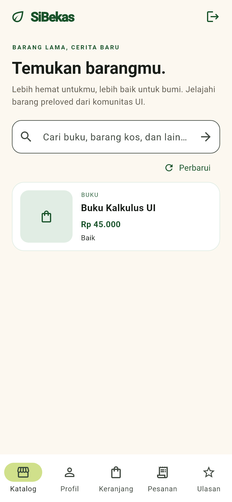

# Pratinjau UI

Contoh halaman katalog ini dirender dari widget Flutter pada ukuran logis 390 x 844. Kartu memakai **fixture pengujian** agar struktur halaman dapat ditinjau tanpa mengekspos data pengguna PWS. Ini bukan tangkapan data produksi; kode aplikasi di `lib/` tetap membaca API Django.

Rancangan kelima modul tersedia pada [wireframe](../wireframes.svg).
